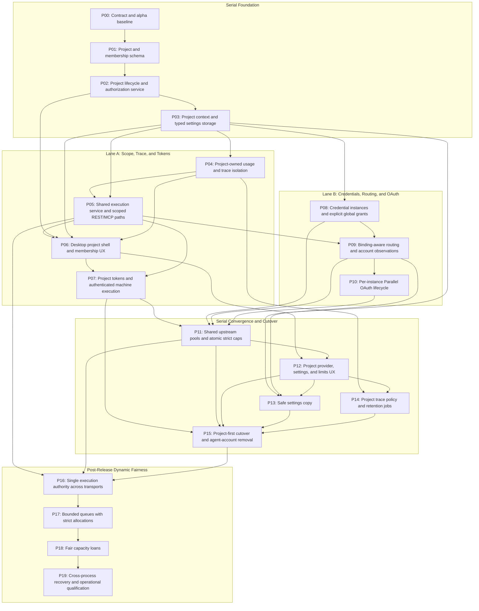

# Projects P00 - Ownership Inventory, Bootstrap Runbook, and Baseline Matrix

## 1. Purpose and Scope

This document provides the technical baseline for Phase P00 of the Projects Architecture.
This document defines:
1. The inventory of current physical tables, routes, caches, and background tasks with target ownership scopes.
2. The planned target tables and phase assignments matching authoritative specifications.
3. The authoritative phase lanes, dependency joins, and parallel file ownership matrix.
4. The safe alpha database test fixture and executable bootstrap runbook.
5. The core domain contracts, immutability rules, and security invariants.
6. The operation mappings and verified baseline matrix.

This document uses Simplified Technical English (STE).

---

## 2. Actual Codebase Inventory

### 2.1 Current Physical SQLite Tables

The physical SQLite database contains seventeen tables at migration head `0005_tinyfish_plan_label`.
On a fresh alpha database, the baseline row count is:
- Exactly 1 row in `alembic_version` (value: `0005_tinyfish_plan_label`).
- Exactly 0 rows across all sixteen application tables.

| # | Current Physical Table | Source Location & SQLAlchemy Class | Current Responsibility | Target Scope | Target Ownership / Disposition |
|---|---|---|---|---|---|
| 1 | `user` | `src/freesearch/persistence/users.py:UserRow` | User credentials, active status, superuser flag, and legacy `role` column (`admin`, `developer`, `agent`). | System | Serves as legacy authorization seam for alpha bootstrap. Replaced by target fresh schema (human users and installation account) in downstream phases without old account migration or import. Humans are never stored as installation accounts. |
| 2 | `auth_sessions` | `src/freesearch/persistence/auth_sessions.py:AuthSessionRow` | Active user sessions, user agent, IP address, and revocation timestamps. | System | Remains system-level user session store. Project context links to sessions in P07/P11. |
| 3 | `refresh_tokens` | `src/freesearch/persistence/auth_sessions.py:RefreshTokenRow` | Cryptographic hash families of rotating refresh tokens. | System | Remains system-level session rotation store. |
| 4 | `login_throttle` | `src/freesearch/persistence/users.py:LoginThrottleRow` | Failed login attempt counters and lockout expiry per client digest. | System | Remains system-level security throttle. |
| 5 | `usage_events` | `src/freesearch/persistence/storage.py:UsageEventRow` | Records operation usage, provider, units, and latency. | Project | Scoped to project and account identifiers in P04/P08. |
| 6 | `runtime_settings` | `src/freesearch/persistence/storage.py:RuntimeSettingRow` | Key-value store for JSON runtime settings and provider configuration. | System | Becomes system-level default configuration store. Overridden by project settings in P03. |
| 7 | `quota_snapshots` | `src/freesearch/persistence/storage.py:QuotaSnapshotRow` | Vendor and local quota snapshots per provider and mode. | Shared-Pool / System | Upstream provider capacity records. Reorganized under quota pools in P09/P11. |
| 8 | `provider_health` | `src/freesearch/persistence/storage.py:ProviderHealthRow` | Provider circuit breaker states, health status, and latency metrics. | System | Shared system provider runtime health table. |
| 9 | `trace_spans` | `src/freesearch/persistence/storage.py:TraceSpanRow` | Distributed tracing spans for search and fetch execution. | Project | Scoped to project and account identifiers in P04. |
| 10 | `provider_limits` | `src/freesearch/persistence/limit_rows.py:ProviderLimitRow` | Static and dynamic rate limits and credit rules per provider. | Shared-Pool / System | Shared upstream provider capability definitions. |
| 11 | `provider_native_pools`| `src/freesearch/persistence/limit_rows.py:NativePoolRow` | Upstream provider native pool balances and tier configurations. | System | Upstream quota pools managed by system admin in P09/P11. |
| 12 | `provider_crd_grants` | `src/freesearch/persistence/limit_rows.py:CRDGrantRow` | Credit allowance grants per provider mode. | Shared-Pool / System | Upstream provider grant store. |
| 13 | `provider_limit_events`| `src/freesearch/persistence/limit_rows.py:LimitEventRow` | Audit log of rate limit and quota adjustment events. | System | System-level provider limit audit trail. |
| 14 | `provider_limit_admissions` | `src/freesearch/persistence/limit_rows.py:LimitAdmissionRow` | Active admission leases for concurrency control. | Shared-Pool / System | Upstream concurrency admission engine. |
| 15 | `provider_rate_observations` | `src/freesearch/persistence/limit_rows.py:RateWindowObservationRow` | Observed provider rate window metrics. | Shared-Pool / System | Upstream provider telemetry store. |
| 16 | `provider_rate_attempts` | `src/freesearch/persistence/limit_rows.py:RateAttemptRow` | Sliding-window attempt timestamps for rate calculation. | Shared-Pool / System | Upstream provider rate tracking. |
| 17 | `alembic_version` | `alembic_version` (Alembic metadata table) | Tracks schema migration revision head (1 row: `0005_tinyfish_plan_label`). | System | Platform schema version management. |

### 2.2 Planned Target Tables

These tables are NOT present in P00. They are introduced in downstream phases per authoritative specification `doc-000003`:

| Planned Target Table | Phase Introduced | Target Scope | Target Schema Responsibility |
|---|---|---|---|
| `accounts` | P01 | System | Internal installation account boundary. |
| `projects` | P01 | System / Project | Multi-tenant project workspace boundary and lifecycle state. |
| `project_memberships` | P01 | Project | Association between human users and projects. |
| `system_role_assignments` | P01 | System | System-scoped RBAC assignments (`account_id`, `user_id`, `role_key`, `granted_by`, `version`). |
| `project_role_assignments` | P01 | Project | Project-scoped RBAC assignments (`project_id`, `user_id`, `role_key`, `granted_by`, `version`). |
| `project_settings` | P03 | Project | Scoped project routing and execution configuration overrides. |
| `project_tokens` | P07 | Project | Hashed project API access tokens for machine execution. |
| `provider_credentials` | P08 | System / Project | System-shared and project-private provider credential instances. |
| `credential_project_grants` | P08 | System / Project | Project access grants for system-owned credentials. |
| `project_provider_bindings` | P08 | Project | Route bindings linking projects to provider credentials. |
| `upstream_quota_pools` | P11 | System | Shared upstream rate and balance pool definitions. |
| `project_pool_allocations` | P11 | Project | Project-specific quota allocations and rate ceilings. |

> [!NOTE]
> Post-cutover dynamic fairness scheduling (P18) and audit implementations remain the work of their respective phases per accepted specifications doc-000002 and doc-000003.

### 2.3 Current API Endpoints and Routers

The application exposes the following HTTP endpoints and MCP tools, with explicit concern classification between System and Project scopes:

#### 1. Execution Router (`src/freesearch/routers/api.py`) - Target Scope: Project
- `POST /search`: Execute search query across configured providers for active project.
- `POST /fetch`: Extract document content from target URL for active project.

#### 2. Monitoring & Aggregated Stats (`src/freesearch/routers/api.py`) - Mixed Concern Classification:
- `GET /stats`: Retrieve aggregated provider usage and error statistics.
  - **System Concern**: Reports platform-wide capacity and provider error aggregates for system operators. System administrators never view project queries or project-private trace content.
  - **Project Concern**: Reports project-isolated usage event summaries and consumption metrics for project members.
- `GET /dashboard`: Retrieve dashboard metrics, quota projections, and recent traces.
  - **System Concern**: Reports platform-wide provider health and upstream pool status. System administrators have no implicit access to private project workspaces.
  - **Project Concern**: Reports project-specific trace timelines, quota projections, and workspace activity for authenticated project members.
- *Note on Health*: There is no unauthenticated `/health` REST route in `api.py`. Provider connectivity health is probed via `POST /api/v1/providers/{provider_id}/test` (Control router). Upstream provider health is recorded in `provider_health` and exposed via `GET /api/v1/providers` (System scope).

#### 3. Auth Router (`src/freesearch/routers/auth.py`) - Target Scope: System
- `POST /auth/register`: Register new local user account.
- `POST /auth/jwt/login`: Authenticate with username and password; returns JWT pair.
- `POST /auth/jwt/refresh`: Rotate refresh token and obtain fresh access token.
- `DELETE /auth/jwt/cookie-refresh`: Revoke browser cookie refresh token.
- `POST /auth/jwt/logout`: Revoke active session family.
- `GET /users/me`: Return authenticated caller identity.
- `POST /api/v1/users`: Administrator endpoint to provision user accounts with initial role.
- Blocked legacy routes (return 405 Method Not Allowed): `GET /api/v1/users/{user_id}`, `PATCH /api/v1/users/{user_id}/role`.

#### 4. Control Router (`src/freesearch/routers/control.py`) - Explicit Concern Classification:
- **Provider Catalog & Diagnostics (System Scope Only)**:
  - `GET /api/v1/providers`: Enumerate provider statuses, capabilities, and health.
  - `GET /api/v1/providers/{provider_id}`: Get status and configuration for one provider.
  - `PATCH /api/v1/providers/{provider_id}`: Update global provider settings (masks, paygo, environment).
  - `POST /api/v1/providers/{provider_id}/test`: Run a timed live health probe on an adapter.
  - `POST /api/v1/providers/{provider_id}/circuit-breaker/reset`: Reset provider circuit breaker.
- **Provider Secrets & Credentials**:
  - **System Scope (Global Shared Secrets)**: `PUT /api/v1/providers/{provider_id}/secret` stores encrypted global API key; `DELETE /api/v1/providers/{provider_id}/secret` removes global key. Global shared credentials and grants are managed strictly at System scope.
  - **Project Scope (Downstream P08)**: Project-private credentials (`PUT /api/v1/projects/{id}/credentials`) and project settings overrides are strictly Project scope. System administrators have no access to project private keys or project workspace configurations.
- **Routing Configuration**:
  - `GET /api/v1/routing/config`: Retrieve global fallback routing preferences (System Scope).
  - `PUT /api/v1/routing/config`: Update global routing preferences (System Scope). Project routing overrides are strictly Project scope (`PUT /api/v1/projects/{id}/settings` in P03).
- **Manual Quota Management (System Scope Only)**:
  - `GET /api/v1/providers/{provider_id}/manual-quota`: Retrieve manual quota overlay.
  - `PUT /api/v1/providers/{provider_id}/manual-quota`: Set manual quota allowance and window.
  - `DELETE /api/v1/providers/{provider_id}/manual-quota`: Clear manual quota overlay.
- **Provider OAuth (Parallel)**:
  - `POST /api/v1/providers/{provider_id}/oauth/device-code`: Start OAuth device flow (System Scope in P00; evolves in P10 to per-instance credential OAuth).
  - `GET /api/v1/providers/{provider_id}/oauth/status`: Query status of OAuth pairing.
  - `DELETE /api/v1/providers/{provider_id}/oauth`: Disconnect and revoke OAuth pairing.

#### 5. Limits Router (`src/freesearch/routers/limits.py`) - Explicit Concern Classification:
- **System Scope (Upstream Provider Limits & Sync)**:
  - `GET /api/v1/providers/{provider_id}/limits`: Enumerate limits and rate observation data.
  - `PATCH /api/v1/providers/{provider_id}/limits/{auth_mode}/{operation}`: Update rate or balance limits.
  - `PUT /api/v1/providers/{provider_id}/crd-grants/{auth_mode}`: Update CRD grant allocations.
  - `GET /api/v1/providers/{provider_id}/limits/history`: Retrieve limit adjustment history.
  - `POST /api/v1/providers/{provider_id}/limits/sync`: Trigger on-demand sync of upstream limits under database lease.
- **Project Scope (Downstream P11)**:
  - Project-specific pool allocations (`project_pool_allocations`) manage tenant rate ceilings without exposing upstream provider secret state.

#### 6. Observability Router (`src/freesearch/routers/observability.py`) - Target Scope: Project Only
- `GET /api/v1/traces`: List execution traces with filtering by operation and outcome.
- `GET /api/v1/traces/{trace_id}`: Retrieve detailed trace hierarchy including child spans.
- *Strict Isolation*: In target architecture (P04), traces carry mandatory `project_id`. Users only see traces for projects where they hold membership. System administrator role gives no implicit visibility into project trace content.

#### 7. MCP Tools Server (`src/freesearch/mcp/server.py`) - Target Scope: Project
- `search`: FastMCP tool for web search queries within the authenticated project context.
- `fetch`: FastMCP tool for web page content extraction within the authenticated project context.

### 2.4 Actual In-Memory Caches

The current codebase maintains two distinct in-memory caches. Their present structure and target evolution are:

1. **Provider Configuration and Policy Cache** (`src/freesearch/routers/control.py:771-772`):
   - **Present Structure & Key**:
     - `_CONFIG_CACHE`: `dict[tuple[int, str], ProviderConfig]`, keyed by `(id(repository), provider_name)`.
     - `_POLICY_CACHE`: `dict[int, RoutingConfigResponse]`, keyed by `id(repository)`.
     - Present Scope: Global process-wide configuration per repository instance. Invalidated via `clear_config_cache(repository, provider)` on settings update or process exit.
   - **Target Scope & Ownership**:
     - System defaults: `system_settings` owned by **System**.
     - Project overrides: `project_settings` (routing and execution configuration) owned by **Project**.
   - **Target Cache Keys**:
     - Global/System: `("system", provider_name)` and `("system", "routing_policy")`.
     - Project-scoped: `("project", project_id, provider_name)` and `("project", project_id, "routing_policy")`.
   - **Target Invalidation Lifecycle**:
     - System settings mutations invalidate `("system", ...)` and cascade to recompute resolved project policies.
     - Project settings mutations invalidate only `("project", project_id, ...)`, strictly isolated from other tenants.

2. **Quota Polling and Failure Backoff Cache** (`src/freesearch/services/monitoring.py:80-82`):
   - **Present Structure & Key**:
     - `_quota_poll_cache`: `dict[tuple[int, int], datetime]`, keyed by `(id(repository), id(adapter))`, caching timestamp of last successful vendor poll. Default TTL is 120 seconds (`QUOTA_POLL_TTL_SECONDS = 120`, bounded 60-300s via `_quota_ttl_seconds()`).
     - `_quota_failure_cache`: `dict[tuple[int, int], datetime]`, keyed by `(id(repository), id(adapter))`, caching timestamp of poll failure. Default backoff is 5 seconds (`QUOTA_FAILURE_BACKOFF_SECONDS = 5`, bounded 1-30s via `_quota_failure_backoff_seconds()`).
     - `_quota_poll_locks`: `dict[tuple[int, int], asyncio.Lock]`, keyed by `(id(repository), id(adapter))`, single-flight lock per adapter instance.
     - Present Scope: Process-wide adapter instances across repository lifespans.
   - **Target Scope & Ownership**:
     - Shared upstream pools: **Shared-Pool** / **System**.
     - Provider credential instances: **Shared-Credential** (system-shared) or **Project** (project-private credential).
   - **Target Cache Keys**:
     - Shared upstream pools: `("pool", pool_id)`.
     - Project-private credentials: `("credential", project_id, credential_id)`.
     - Never keyed solely by raw adapter identity across tenants.
   - **Target Invalidation Lifecycle**:
     - Cache entries expire on bounded TTL or failure backoff.
     - Evicted on credential rotation (`credential_generation` increment) or grant revocation.

### 2.5 Actual Background Tasks

The application runs asynchronous background mechanisms with the following present and target scopes:

1. **Periodic Limit Sync Service** (`src/freesearch/services/limits_sync.py:LimitSyncService`):
   - **Present Structure**: Singleton background loop started during application lifespan in `api.py` (line 484) and MCP server in `mcp/server.py` (line 129). Runs `LimitSyncService.run(stop_event)` polling due providers under database lease (`SyncClaim`), persisting to limit tables.
   - **Target Scope & Ownership**: **System / Shared-Pool**. Synchronizes vendor allowances for shared upstream quota pools and system credentials. Does not inspect, poll, or mutate project-private execution buffers. Partitioned by `pool_id` and `credential_id` in P09/P11.

2. **Non-Blocking Background Quota Refresh** (`src/freesearch/routers/api.py:680`, `src/freesearch/mcp/server.py:440`):
   - **Present Structure**: Spawned via `loop.create_task(refresh_quotas(...))` during execution dispatch without blocking response latency.
   - **Target Scope & Ownership**: **Shared-Pool** (for shared credentials) or **Project** (for project-private credentials). Scoped to the resolved `pool_id` or `(project_id, credential_id)` of the dispatch route.

3. **OpenTelemetry Trace Flush on Shutdown** (`src/freesearch/routers/api.py:246`, `src/freesearch/mcp/server.py:388`):
   - **Present Structure**: `asyncio.to_thread(_tracer_provider.shutdown)` during lifespan teardown.
   - **Target Scope & Ownership**: **System** process lifecycle hook, flushing spans that carry strict project and account attribution (P04).

4. **Downstream Planned Background Tasks** (from `doc-000002` and `doc-000003`):
   - **Per-instance Parallel OAuth refresh job** (P10): Scope: **Shared-Credential** (system) or **Project** (private). Refreshes expiring tokens per credential instance.
   - **Project trace retention job** (P14): Scope: **Project**. Purges expired traces per project retention configuration.

---

## 3. Authoritative Phase Lanes and Dependency Tree

This phase breakdown strictly aligns with authoritative specification `doc-000005`.

### 3.1 Canonical Ticket Map

| Phase | Ticket | Work | Depends on | Lane |
|---|---|---|---|---|
| P00 | TASK-000017 | Contract and alpha baseline | None - start here | serial-foundation |
| P01 | TASK-000018 | Project and membership schema | TASK-000017 | serial-foundation |
| P02 | TASK-000019 | Project lifecycle and authorization service | TASK-000018 | serial-foundation |
| P03 | TASK-000020 | Project context and typed settings storage | TASK-000019 | serial-foundation |
| P04 | TASK-000021 | Project-owned usage and trace isolation | TASK-000020 | parallel-a |
| P05 | TASK-000022 | Shared execution service and scoped REST/MCP paths | TASK-000020, TASK-000021 | parallel-a |
| P06 | TASK-000023 | Desktop project shell and membership UX | TASK-000019, TASK-000020, TASK-000021, TASK-000022 | parallel-a |
| P07 | TASK-000006 | Project tokens and authenticated machine execution | TASK-000022, TASK-000023 | parallel-a |
| P08 | TASK-000024 | Credential instances and explicit global grants | TASK-000020 | parallel-b |
| P09 | TASK-000025 | Binding-aware routing and account observations | TASK-000022, TASK-000024 | parallel-b |
| P10 | TASK-000026 | Per-instance Parallel OAuth lifecycle | TASK-000024, TASK-000025 | parallel-b |
| P11 | TASK-000027 | Shared upstream pools and atomic strict caps | TASK-000006, TASK-000024, TASK-000025, TASK-000026 | serial-join |
| P12 | TASK-000005 | Project provider, settings, and limits UX | TASK-000023, TASK-000024, TASK-000025, TASK-000026, TASK-000027 | serial-join |
| P13 | TASK-000028 | Safe settings copy | TASK-000020, TASK-000025, TASK-000005 | parallel-copy |
| P14 | TASK-000029 | Project trace policy and retention jobs | TASK-000021, TASK-000005 | parallel-retention |
| P15 | TASK-000004 | Project-first cutover and agent-account removal | TASK-000006, TASK-000027, TASK-000005, TASK-000028, TASK-000029 | serial-release |
| P16 | TASK-000030 | Single execution authority across transports | TASK-000022, TASK-000027, TASK-000004 | serial-fairness |
| P17 | TASK-000031 | Bounded queues with strict allocations | TASK-000030 | serial-fairness |
| P18 | TASK-000032 | Fair capacity loans | TASK-000031 | serial-fairness |
| P19 | TASK-000033 | Cross-process recovery and operational qualification | TASK-000032 | serial-fairness |

### 3.2 Canonical Dependency Graph

> [!NOTE]
> The diagram below is a transitive simplification for visual readability. Table 3.1 and `doc-000005` define the exact authoritative dependency prerequisites (including direct edges P08->P10 and P08/P09/P10->P12).



### 3.3 Parallel File Ownership and Collision Prevention Matrix

Lane A (P04-P07) and Lane B (P08-P10) execute concurrently. To prevent git merge collisions and schema divergence, agents and developers must follow strict file ownership rules:

| Shared File / Subsystem | Lane A Owner (Phase) | Lane B Owner (Phase) | Collision Prevention Rule / Serialization Order |
|---|---|---|---|
| `src/freesearch/persistence/storage.py`<br>`src/freesearch/persistence/database_migrations.py`<br>`alembic/versions/` | P04: Scopes `usage_events` and `trace_spans` to project/account. | P08: Adds `provider_credentials`, `credential_project_grants`, `project_bindings`. | **Serialized Alembic Revisions**: P04 merges first. P08 re-bases on the merged P04 migration head before adding credential tables. No parallel branch may generate conflicting migration version heads. |
| `src/freesearch/models/projects.py`<br>`src/freesearch/models/contracts.py` | P05 / P06 / P07: Consumes project context and token models. | P08 / P09 / P10: Consumes credential instance and binding models. | **Immutable Contract Seam**: P00 defines shared contracts. If downstream adjustments are required, contract edits must be committed serially to main before lane work begins. |
| `src/freesearch/services/execution.py`<br>Provider Adapters (`src/freesearch/adapters/`) | P05: Extracts common execution service and project context dispatch. | P09: Adds credential-aware binding resolution and multi-account dispatch. | **Dependency Ordering**: P09 explicitly depends on P05 (`TASK-000022`). Lane B does not touch execution dispatch until P05 completes and merges. |
| `src/freesearch/main.py`<br>Application Lifespan Roots | P07: Wires project token authentication dependencies. | P10: Wires per-instance OAuth refresh background tasks. | **Serial Convergence Join**: DI registrations for tokens and OAuth remain isolated in respective routers (`auth.py`, `control.py`). Unified app-level composition is finalized at P11 convergence. |
| `freesearch-ui/src/` (Settings & Configuration UI) | P14: Project trace policy and retention controls. | P13: Safe settings copy dialog. | **Route Isolation**: P13 owns the copy modal dialog (`ProjectSettingsCopyDialog.tsx`); P14 owns the trace policy tab (`ProjectTraceRetentionSettings.tsx`). Shared route definitions in `App.tsx` merge serially. |

---

## 4. Safe Alpha Database Test Fixture and Bootstrap Runbook

### 4.1 Safety Guarantees
- The test fixture `create_alpha_test_db(db_path)` strictly refuses existing files. If `db_path.exists()` is true, it raises `FileExistsError`.
- It NEVER unlinks, removes, or overwrites existing database files.
- Tests must pass dedicated temporary paths generated via `tempfile.TemporaryDirectory` or pytest `tmp_path`.
- Test databases are preserved or cleaned up cleanly by test fixture lifecycle hooks without touching developer or production files.

### 4.2 Current Schema Seam vs Future Persisted Entities
- In P00, `create_alpha_test_db` initializes the actual SQLite schema up to Alembic head `0005_tinyfish_plan_label` (17 tables total: 16 application tables + `alembic_version`).
- In the current schema, the `user` table holds `role = 'admin'`. This represents the system administrator seam until P15 cutover.
- Target contracts (`ProjectRead`, `RoleAssignmentRead`, `ProjectTokenRead`, etc.) exist as shared Python domain models in `src/freesearch/models/projects.py`.
- **Contract Boundary**: P00 fixtures do NOT claim persisted project rows, valid multi-tenant project sessions, or live project token endpoints. Those tables are created in P01 (project schema) and P07 (tokens).

### 4.3 Safe Bootstrap Procedure

The bootstrap procedure executes in six explicit stages:
1. **Stage 1 (Allocation)**: Allocate an isolated, non-existent database file path.
2. **Stage 2 (Migration)**: Run Alembic migrations to current head (`0005_tinyfish_plan_label`).
3. **Stage 3 (Validation)**: Validate physical table schema integrity.
4. **Stage 4 (System Seam)**: Seed initial administrative user into the SQLite `user` table.
5. **Stage 5 (Target Model Projection)**: Build in-memory target contracts (`AccountRead`, `ProjectRead`, `RoleAssignmentRead`, `ProjectContext`).
6. **Stage 6 (Safe Cleanup)**: Explicitly close repository connections before temporary directory exit to prevent Windows SQLite file handle locks (`[WinError 32]`).

Executable Python runbook snippet:

```python
import asyncio
from pathlib import Path
from tempfile import TemporaryDirectory
from tests.fixtures.alpha_fixtures import AlphaBootstrapResult, bootstrap_fresh_alpha


async def run_alpha_bootstrap() -> AlphaBootstrapResult:
    """Execute isolated alpha bootstrap with safe Windows file cleanup."""
    with TemporaryDirectory() as temp_dir:
        db_path = Path(temp_dir) / "alpha_workspace.db"
        result = await bootstrap_fresh_alpha(
            db_path,
            admin_email="admin@freesearch.local",
            project_name="Initial Alpha Workspace",
        )
        try:
            # Result yields:
            # - result.database_path: Isolated SQLite database path
            # - result.repository: Active SQLiteRepository instance
            # - result.admin_user: UserRow in local SQLite user table
            # - result.admin_principal: HumanPrincipal
            # - result.default_project: In-memory ProjectRead contract
            # - result.system_role_assignment: RoleAssignmentRead contract
            # - result.project_admin_context: ProjectContext contract
            assert result.database_path.exists()
            assert result.admin_user.is_superuser is True
            assert result.default_project.name == "Initial Alpha Workspace"
            return result
        finally:
            # Invariant: Close repository before TemporaryDirectory context exit
            await result.repository.close()


if __name__ == "__main__":
    asyncio.run(run_alpha_bootstrap())
```

---

## 5. Target Core Contracts and Security Invariants

All contracts are implemented in `src/freesearch/models/projects.py`.

### 5.1 Deep Immutability
- `HumanPrincipal`, `ProjectTokenPrincipal`, and `ProjectContext` are deeply immutable using `ConfigDict(frozen=True, extra="forbid")`.
- Mutating any attribute or nested principal after instantiation raises `ValidationError`.

### 5.2 Token Principal Project Invariant
- When a `ProjectContext` contains a `ProjectTokenPrincipal`, the validator strictly enforces:
  `principal.project_id == context.project_id`.
  A mismatch raises `ValidationError`.

### 5.3 Token Scope Restrictions
- Project API tokens are strictly restricted to execution actions:
  `ALLOWED_TOKEN_ACTIONS = {PermissionAction.SEARCH_EXECUTE, PermissionAction.FETCH_EXECUTE}`.
- Any attempt to create a token or initialize a token principal with management scopes (such as `members.manage`, `tokens.manage`, `settings.write`, `project.archive`) raises `ValidationError`.

### 5.4 Role Assignment and Member Scope Invariants
- `RoleAssignmentRead` validates that role scope matches assignment scope:
  - System roles (`system_admin`) cannot be assigned at `project` scope.
  - Project roles (`project_admin`, `project_member`, etc.) cannot be assigned at `system` scope.
- `ProjectMemberAdd` enforces that initial roles assigned to members must have `project` scope.

### 5.5 Credential Owner Scope Invariant
- `CredentialInstanceRead` strictly enforces:
  - Project-scoped credentials (`owner_scope="project"`) must have non-null `owner_project_id`.
  - System-scoped credentials (`owner_scope="system"`) must have `owner_project_id=None`.

### 5.6 One-Time Token Wire Boundary and Leak Prevention
- `ProjectTokenIssueResponse` exposes unmasked `secret` and `raw_token` for one-time client delivery.
- Default `repr()` and `str()` mask the secret value (`secret='**********', raw_token='**********'`) to prevent accidental logging leaks.
- Dedicated wire serialization (`to_one_time_wire_payload()`) and standard Pydantic serialization (`model_dump()`, `model_dump_json()`) provide unmasked secrets for wire transport.
- Deserialization accepts either `secret` or `raw_token` bidirectionally.

### 5.7 Optional Token Expiry Semantics
- Caller omits `expires_at`: Resolves to policy proposal default of 90 days from creation (`DEFAULT_TOKEN_LIFETIME_DAYS = 90`).
- Caller supplies explicit `expires_at: null`: Resolves to `None` (perpetual token with no expiration).
- Caller supplies explicit UTC timestamp: Resolves to the specified datetime.
- Serialization preserves omission, explicit null, and timestamp representations across JSON roundtrips.

### 5.8 Atomic First Project Administrator
- `ProjectCreate` requires `initial_admin_user_id: UUID`.
- Projects cannot be created in an orphaned state without an initial project administrator.

### 5.9 Common Authorization Service Protocol and Deny-by-Default
- `AuthorizationService` is defined as a runtime checkable `Protocol` requiring:
  `authorize(query: AuthorizationQuery) -> AuthorizationDecision`.
- Evaluator `evaluate_authorization()` operates strictly deny-by-default:
  - Missing permissions or empty context -> Denied (`allowed=False`).
  - Action not present in granted permissions -> Denied.
  - Machine tokens evaluated first: Token principals cannot execute at system scope, cannot access cross-project resources (`scope_id != token.project_id`), and cannot invoke actions outside granted token scopes.
  - Project actions require project scope and non-null `scope_id`.
  - System actions require system scope.
  - **No system-admin project bypass**: A system administrator does not possess implicit project permissions unless granted a project role or operating at system scope.

### 5.10 Typed Settings Inheritance and Resolution
- `RoutingSettings` and `ExecutionSettings` provide strict field-level typing for configuration.
- `ProjectSettingsDocument` models project-level configuration overrides with document revision tracking.
- `SettingsFieldResolution` records field values, null status, and origin provenance (`SettingsProvenance`: `system_default`, `project_override`, `system_constrained`).

---

## 6. Baseline Matrix and Operations Mapping

### 6.1 Operations and Security Contract Mapping

| Route / Surface | HTTP / Tool | Required Permission | Allowed Principal Types | Target Scope |
|---|---|---|---|---|
| Search Execution | `POST /search` | `search.execute` | Human, ProjectToken | Project |
| Fetch Execution | `POST /fetch` | `fetch.execute` | Human, ProjectToken | Project |
| Stats Summary | `GET /stats` | `usage.read` | Human | Project / System |
| Dashboard Read | `GET /dashboard` | `traces.read`, `usage.read` | Human | Project / System |
| Trace Details | `GET /api/v1/traces/{id}` | `traces.read` | Human | Project |
| Project Management | `POST /api/v1/projects` | `project.create` | Human | System |
| Project Archive | `POST /api/v1/projects/{id}/archive` | `project.archive` | Human | Project |
| Membership Manage | `POST /api/v1/projects/{id}/members` | `members.manage` | Human | Project |
| Token Creation | `POST /api/v1/projects/{id}/tokens` | `tokens.manage` | Human | Project |
| Settings Write | `PUT /api/v1/projects/{id}/settings` | `settings.write` | Human | Project |
| Provider Private Keys | `PUT /api/v1/projects/{id}/credentials` | `credentials.manage_private` | Human | Project |
| System Settings Write | `PUT /api/v1/system/settings` | `system.settings.write` | Human (System Admin) | System |

### 6.2 Baseline Execution Matrix

> [!NOTE]
> **Baseline Snapshot Caveat**: The collection metrics and dry-run counts below record the repository test inventory established during initial qualification prior to P00 implementation.
> Changed P00 contract and model test counts are tracked separately in the focused verification table.
> Full test suites and E2E browser tests were not executed for this baseline task, in accordance with user instructions.

#### 1. Repository Collection & Inventory Baseline

| Verification Dimension | Exact Command Invocations | Factual Collected Metric | Status / Verification Evidence |
|---|---|---|---|
| Dependency Graph Health | `bunx backlog.md doctor` | 20 phases analyzed | 0 duplicate IDs, 0 self-cycles, 0 dependency cycles. Graph verified clean. |
| Backend Unit Test Catalog | `uv run pytest --collect-only tests/unit` | 1,836 tests collected | Clean unit test collection established. |
| Backend Integration Catalog | `uv run pytest --collect-only tests/integration` | 834 tests collected | Clean integration test collection established. |
| Acceptance BDD Suite Dry-Run | `uv run behave --dry-run tests/bdd/features` | 27 features, 281 scenarios, 1,306 steps | Dry-run syntax and step validation complete (live-key feature dry-run only). |
| Frontend Component Catalog | In freesearch-ui: `npx vitest list` | 1,797 test cases across 116 files | Component and store test catalog enumerated. |

#### 2. Focused Blast Radius Verification

| Focused Subsystem | Targeted Test Files / Invocations | Tests Passed | Verification Result |
|---|---|---|---|
| Auth & Session Lifecycle | `uv run pytest tests/unit/models/test_users.py tests/unit/routers/test_auth.py tests/unit/services/test_users.py` | 49 passed | Verified JWT login, session cookies, refresh rotation, and revocation. |
| Routing & Rate Controls | `uv run pytest tests/unit/services/test_routing.py tests/unit/services/test_rate_limits.py tests/unit/models/test_provider_limits.py` | 62 passed | Verified provider configuration, vault encryption, limits, and sync services. |
| Auth & Role Integration | `uv run pytest tests/integration/persistence/test_users.py tests/integration/persistence/test_auth_sessions.py tests/integration/routers/test_role_matrix.py` | 31 passed | Verified user persistence, auth sessions, and role matrix (not storage migration tests). |
| Desktop UI Core Components | In freesearch-ui: `npx vitest run --configLoader native src/features/users/model/useAdminUsersController.test.ts src/app/layout/SidebarNavList.test.tsx src/app/layout/SidebarBrand.test.tsx src/features/users/ui/AdminUsersPage.test.tsx src/app/layout/SidebarAccountMenu.test.tsx src/components/layout/Sidebar.test.tsx src/components/layout/AppSidebarShell.test.tsx` | 152 passed across 7 files | Verified focused admin user controller and sidebar layout components. |
| Core BDD Acceptance | `uv run behave tests/bdd/features/users.feature:7` | 1 scenario passed | Acceptance step execution verified (1 scenario passed, not one feature search_dispatch). |
| Projects P00 Domain Contracts | `uv run pytest tests/unit/models/test_projects.py` | 21 passed | Verified 21 P00 contract tests, immutability, token wire boundaries, evaluator, and safe DB bootstrap (distinct from pre-P00 inventory). |
| Static Code Quality | `uv run ruff check src/freesearch/models/projects.py src/freesearch/configuration/config.py tests/fixtures/alpha_fixtures.py tests/unit/models/test_projects.py`<br>`uv run mypy src/freesearch/models/projects.py src/freesearch/configuration/config.py tests/fixtures/alpha_fixtures.py tests/unit/models/test_projects.py` | 0 errors | Scoped Ruff and MyPy static checks clean across all 4 touched project files. |
