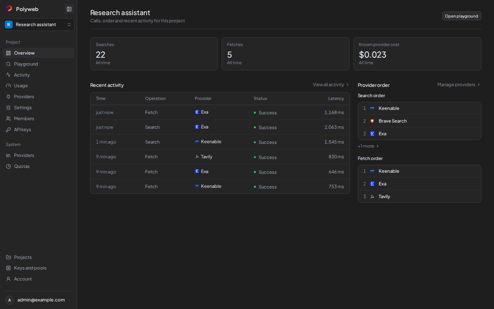

# Polyweb MCP

One dashboard, one API, and one MCP server for web search and page fetch across 8 providers.



## Use the dashboard

1. Open the UI (main port: `http://127.0.0.1:5174`), register or sign in.
2. Open a project, then open **Playground**.
3. Type a question and press Search. Each result shows its provider and cost.
4. Switch to the Fetch tab with a URL to read the full page text.
5. Open **Activity** to see what was sent and received for each call.

Guides: [Your first search](polyweb-docs/src/content/docs/guides/first-search.mdx),
[Playground](polyweb-docs/src/content/docs/dashboard/playground.md),
[Dashboard tour](polyweb-docs/src/content/docs/dashboard/overview.md).

## Use it from an AI agent (MCP)

The MCP server exposes `search` and `fetch` tools. It needs a project API
key: create one in the UI under **API keys**, then connect:

```json
{ "type": "streamable-http", "url": "http://127.0.0.1:8000/mcp" }
```

Details: [Connect an agent](polyweb-docs/src/content/docs/mcp/connect.mdx),
[`search` tool](polyweb-docs/src/content/docs/mcp/search-tool.mdx),
[`fetch` tool](polyweb-docs/src/content/docs/mcp/fetch-tool.mdx),
[Authentication and keys](polyweb-docs/src/content/docs/concepts/authentication.md).

## Use it from code (REST)

```bash
curl -X POST http://127.0.0.1:8001/search \
  -H "Authorization: Bearer <PROJECT_API_KEY>" \
  -H "Content-Type: application/json" \
  -d '{"query": "solar panel prices", "limit": 5}'
```

Details: [REST overview](polyweb-docs/src/content/docs/api/overview.md),
[`POST /search`](polyweb-docs/src/content/docs/api/search.md),
[`POST /fetch`](polyweb-docs/src/content/docs/api/fetch.md),
[Examples](polyweb-docs/src/content/docs/api/examples.md).

## Providers

Brave (search only), Exa, Firecrawl, Tavily, Parallel, You.com, Keenable
(keyless tier or key), Tinyfish. Keys live in the encrypted vault through
the dashboard, never in `.env`.

Details: [Request options](polyweb-docs/src/content/docs/providers/request-options.md),
[Rate limits and budgets](polyweb-docs/src/content/docs/concepts/limits-and-budgets.md).

## Setup (5 minutes)

Needs: Python `>= 3.12, < 3.14`, [uv](https://docs.astral.sh/uv/),
Node.js `>= 20`, [pnpm](https://pnpm.io/).

```bash
git clone https://github.com/polyweb-dev/polyweb-mcp.git
cd polyweb-mcp
cp .env.example .env
# In .env set: POLYWEB_AUTH_JWT_SECRET (32+ random chars),
# POLYWEB_API_PORT and POLYWEB_MCP_PORT (no defaults; missing = error).
uv sync
uv run polyweb-db upgrade
uv run polyweb-api
```

New terminal, start the dashboard:

```bash
cd polyweb-ui
pnpm install
pnpm dev
```

Open the printed URL (main: `http://127.0.0.1:5174`). Sign in, open a
project, and search. Full steps: [Manual setup](polyweb-docs/src/content/docs/setup/manual.md),
[Configuration](polyweb-docs/src/content/docs/setup/configuration.md).
Docker and contributing:
[Quick start](polyweb-docs/src/content/docs/quick-start.md),
[Contributing](polyweb-docs/src/content/docs/reference/contributing.md).

## Project layout

```
freesearch/
├── src/polyweb/      # backend: adapters, routers, MCP server, vault
├── polyweb-ui/       # React dashboard
├── polyweb-docs/     # docs site (Starlight; README links here)
├── polyweb-landing/  # marketing site
└── tests/            # unit, integration, and BDD tests
```

Checks: backend `uv run pytest`; UI `pnpm test` from `polyweb-ui`;
docs `pnpm build` from `polyweb-docs`.

More: [Security](polyweb-docs/src/content/docs/reference/security.md).
