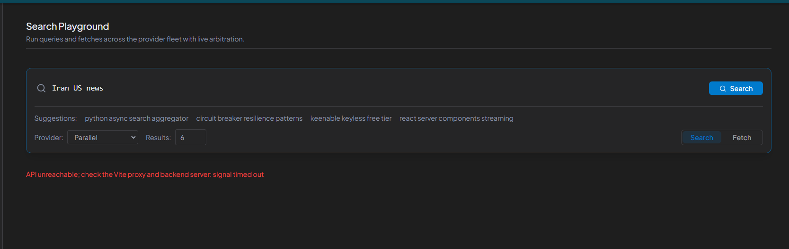
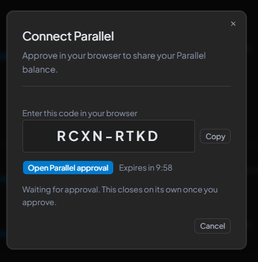

1. The UI fails the first request when you search from it, then opens on the second request. Check that out. 

2. The Brave search is failing quite a few times, but it worked in the last test. When you use the Brave search, the request is not updated, so the usage isn't ticking down. Check that out. Quota details can probably show the exact usage, like we already have a progress bar showing the approximate usage, and I don't think it is ticking down; that needs to be verified. 

3. Exa is still to be linked; it has not been linked properly yet. 

4.  The form model looks kind of ugly, so I think it can be improved in design and alignment. This is for connecting to parallel to get the budget. 