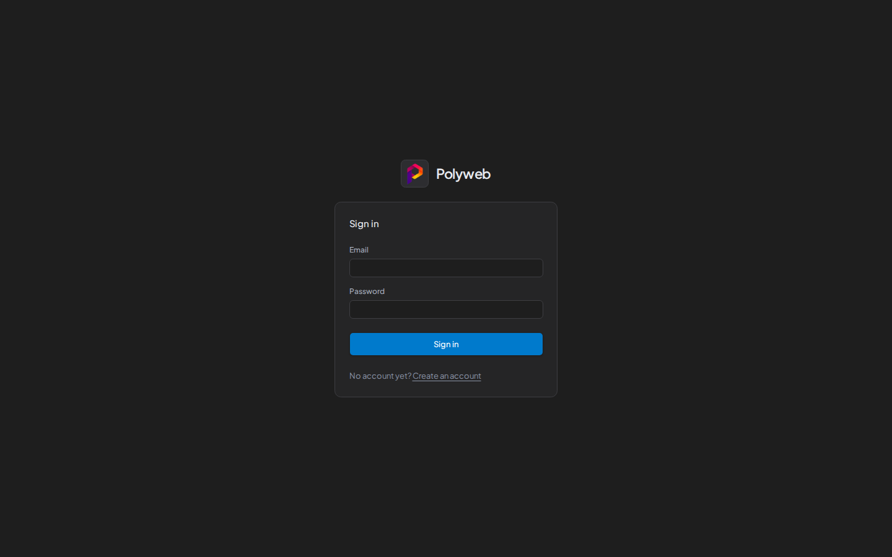

You use an email address and password to sign in. Machines such as agents and scripts never sign in this way. They use a [project API key](/dashboard/api-keys/).

## Sign in

1. Open the dashboard, for example `http://localhost:3000`.
2. Enter your **Email** and **Password**.
3. Press **Sign in**.

If you followed a link to a specific page, you land there after you sign in. Links to other sites are ignored and send you to the dashboard home page instead.

A failed attempt shows "Sign-in failed. Check your email address and password." The session ends if its refresh cookie expires, and you return to the sign-in page.

## Create an account

On the sign-in page, press **Create an account**.

1. Enter your **Email**.
2. Enter a **Password** of 12 to 128 characters, then repeat it in **Confirm password**.
3. Press **Create account**.

Registration does not sign you in. Press **Go to sign in** and use the credentials you just registered.

Every new account is an ordinary user with no projects. A system admin has to add you to a project before you see anything. Only the command line can create a system admin, as described in [Admin accounts](/setup/admin-accounts/).

## Check your account

Press **Account** in the sidebar. The page lists your **Email**, your **Name** if the account has one, and your **Sign-in method**, which is either "Email and password" or "Single sign-on".

## Sign out

Open the account row at the bottom of the sidebar (the button named "Open user menu") and press **Sign out**. The same menu has an **Account** link.

## Troubleshooting

| Symptom | Fix |
| --- | --- |
| "Sign-in failed" | Check the email and password, then try again. |
| Registration fails | The email may already be in use, or the password is outside 12 to 128 characters. |
| "The two passwords do not match." | Re-enter both password fields. |
| You are signed in but see no projects | Ask a system admin to add you to a project. |

## Next steps

- [Dashboard tour](/dashboard/overview/) shows what you can do once you are in.
- [Authentication and keys](/concepts/authentication/) explains sessions, project API keys, and permissions.
