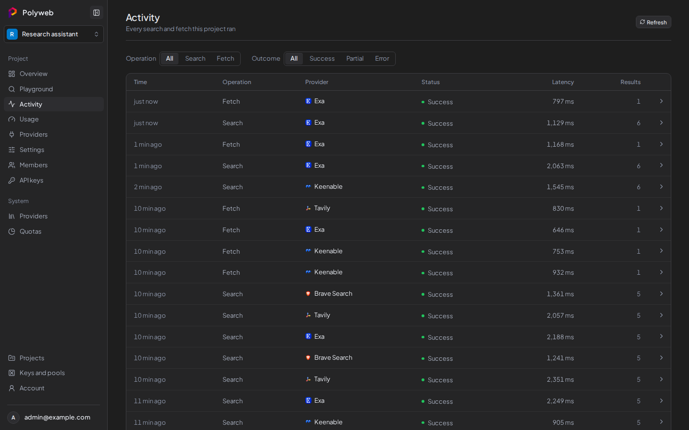
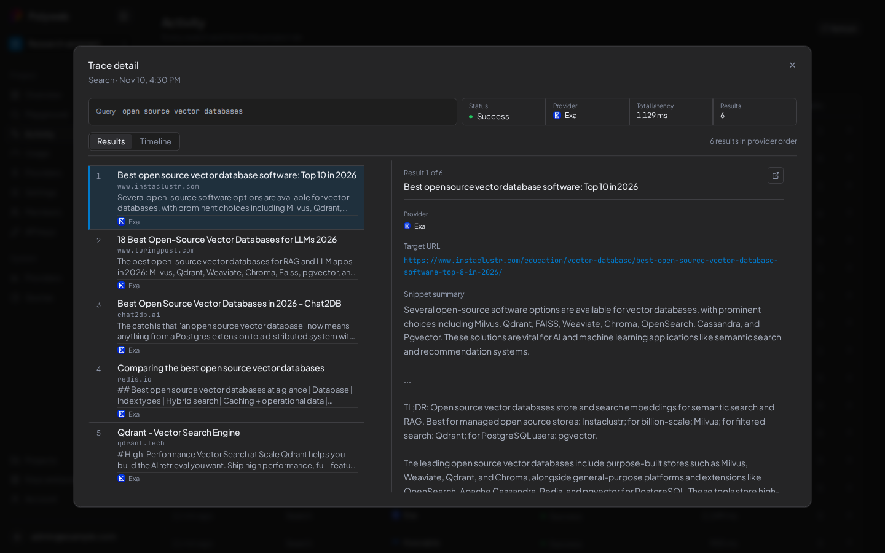

Every `search` and `fetch` call, from the dashboard, the REST API or an MCP client, is recorded as a trace. The **Activity** page lists them, newest first. You need the **View activity** permission (`traces.read`).

Reading Activity doesn't create traces. Health checks, the dashboard's own reads and static requests aren't traced either.



## Find a call

The table has the columns **Time**, **Operation**, **Provider**, **Status**, **Latency** and **Results**.

1. Open your project, then open **Activity**.
2. Use the **Operation** filter (**All**, **Search**, **Fetch**) and the **Outcome** filter (**All**, **Success**, **Partial**, **Error**). The filters are kept in the page address.
3. Select **Refresh** to load new calls. Select **Load more** at the bottom for older ones.

**Partial** means a provider failed but another one answered, so the caller still got a result. A row for **All providers** has an arrow: open it to see each provider's attempt.

Every REST and MCP answer carries an `X-Trace-Id` header (32 lowercase hex characters). It matches the `trace_id` of the trace, so you can find the call an agent made.

## Open a trace

Select a row (or **View details**) to open **Trace detail**. It starts with a summary: **Status**, **Provider**, **Total latency** and **Results**.



Two views sit below it.

- **Results** shows the **Query** (or **URL**) and the **Ranked results**. Select a result to inspect it.
- **Timeline** shows each stage of the call with its timing: the request, the route choice, each provider call, parsing and the response. Select a stage to see its recorded data.

A trace with a **Metadata only** tag stored timing only, so there's no query or results to show and the first view is called **Summary**.

## What gets stored

Each project's trace policy decides how much is kept. **Metadata only** stores timing, provider, outcome, counts and span metadata. **Full requests** also stores the query or URL and the normalized results. The policy is fixed when a request starts, so changing it later doesn't affect a call already running. Secrets, API keys and cookies are never stored.

Trace content is kept in the Polyweb database and is sensitive. It stays until the project's retention setting deletes it. Change both settings under [Project settings and members](/dashboard/project/).

To turn tracing off for the whole installation, set `POLYWEB_OTEL_PROCESSOR=none` and restart. Then calls get no `X-Trace-Id` header and Activity stays empty. The default is `database`. See [Configuration](/setup/configuration/).

## Read traces over REST

The dashboard uses two routes you can call yourself with a signed-in user's access token. Project API keys don't work here.

```bash
curl http://localhost:8001/api/v1/projects/PROJECT_ID/traces \
  -H "Authorization: Bearer ACCESS_TOKEN"
```

```bash
curl http://localhost:8001/api/v1/projects/PROJECT_ID/traces/TRACE_ID \
  -H "Authorization: Bearer ACCESS_TOKEN"
```

The list accepts `limit`, `operation` (`search` or `fetch`), `outcome` and `cursor`. A trace from another project returns `404`.

## Troubleshooting

| Symptom | Fix |
| --- | --- |
| "No traces recorded yet" | Run a search or fetch in the [Playground](/dashboard/playground/). |
| "No traces match these filters" | Set both filters to **All**. |
| **Activity** is missing from the sidebar | You lack **View activity**. Ask a project admin. |
| No `X-Trace-Id` header | Tracing is off. Set `POLYWEB_OTEL_PROCESSOR=database` and restart. |

## Next steps

- See totals per provider in [Usage](/dashboard/usage/).
