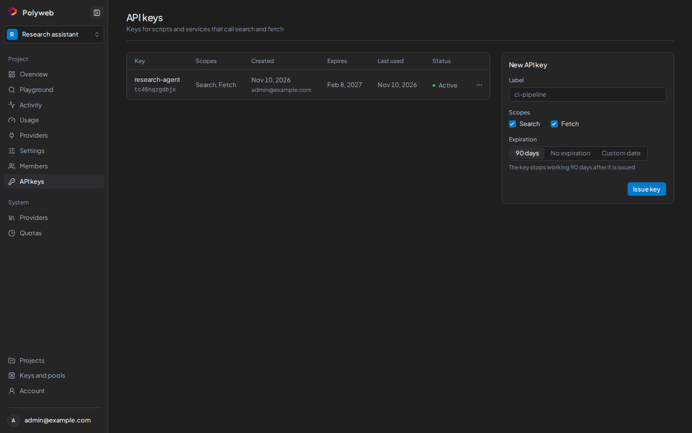

A project API key lets an agent over MCP, or your own code over REST, call `search` and `fetch` for one project. It carries only those two permissions and never your sign-in rights. Keys look like `fs_live_` followed by a 12-character prefix and a secret.

You need permission to manage API keys in the project, which project admins have by default. The key page is **API keys** in the project sidebar.



## Create a project API key

1. Open the project and press **API keys**.
2. In the **New API key** form, enter a **Label** such as `ci-pipeline`.
3. Under **Scopes**, tick **Search**, **Fetch**, or both. These map to `search.execute` and `fetch.execute`. A scope you don't hold yourself is disabled.
4. Choose an **Expiration**: **90 days** (the default), **No expiration**, or **Custom date**. A custom date is `YYYY-MM-DD`, and the key stops working at the end of that day.
5. Press **Issue key**.
6. In the **Copy your new API key** dialog, press **Copy key** and store it in a secret manager.
7. Press **Done**.

Polyweb shows the key only once. If you lose it, rotate the key to get a new one.

## Use the key

Send the key as a Bearer token in the `Authorization` header, and never in a URL. Replace `fs_live_REPLACE_ME` with your key.

```bash
curl -X POST http://localhost:8001/search \
  -H "Authorization: Bearer fs_live_REPLACE_ME" \
  -H "Content-Type: application/json" \
  -d '{"query": "solar panel prices", "limit": 5}'
```

For an MCP client, put the same header in its server configuration. See [Connect an agent](/mcp/connect/). For REST details, see [REST API overview](/api/overview/).

A key can only act for its own project. A key with only the **Search** scope gets a `403` from `fetch`, and the other way round.

## Read the key list

The table shows each key's label and prefix, its **Scopes**, **Created**, **Expires**, **Last used**, and **Status**: active, expired, or revoked. Use the prefix to tell keys apart. The secret is never shown here.

## Rotate a key

Rotation issues a replacement and lets the old key keep working for a while, so you can update your agent without downtime.

1. Open the row menu of an active key and press **Rotate key**.
2. Set **Old key stays valid for**: **Revoke old key now**, **1 hour**, **24 hours** (the default), or **7 days**.
3. Set **Expiration** for the new key. **Keep current** gives it the old key's expiry date.
4. Press **Rotate key**, then copy the new key from the dialog.

You can't rotate a key that is revoked, expired, or already rotated.

## Revoke a key

Open the row menu and press **Revoke key**, then confirm. Programs that use the key stop working at once, and you can't undo it. Only active keys have a menu.

## Permissions and limits

| Situation | What happens |
| --- | --- |
| You can't manage API keys | The **API keys** link is hidden. Ask a project admin. |
| The project is archived | You can revoke keys, but not issue or rotate them. |
| A key is unknown, expired, or revoked | REST returns `401`. |
| A key lacks the scope for the call | REST returns `403`. |

See [Authentication and keys](/concepts/authentication/) for how project API keys differ from sign-in sessions.

## Next steps

- [Connect an agent](/mcp/connect/) to the MCP server with your new key.
- [Playground](/dashboard/playground/) lets you try a call without a key.
