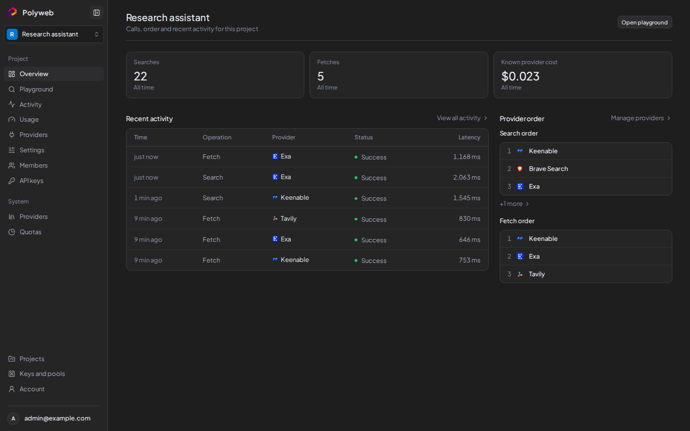

The dashboard is where you set up providers, create project API keys, try searches, and review what your agents did. It runs at `http://localhost:3000` in the Docker setup and uses a dark theme only.

## Projects

After you sign in, Polyweb opens the last project you used. If you have none yet, it shows the **Projects** page, which lists every project you belong to with its name, slug, and creation date. Click a row to open that project.

If you see "You are not a member of any project", ask a system admin to add you. System admins also get a **New project** form on this page. Enter a **Project name** and the **First administrator email**, then press **Create project**. The first administrator must already have an account.

To switch projects later, use the project selector at the top of the sidebar. It keeps you on the same section when you switch.

## The sidebar

The sidebar has two parts. The project sections apply to the project you have open. The links at the bottom are global.

| Link | Where it goes | Who sees it |
| --- | --- | --- |
| **Overview** | The project summary | Anyone who can read the project |
| **Playground** | Run `search` and `fetch` by hand | Members who can run search or fetch |
| **Activity** | Recorded calls (traces) | Members who can read traces |
| **Usage** | Calls and cost per provider | Members who can read usage |
| **Providers** | Which providers serve the project | Members who can read providers |
| **Settings** | Project settings | Members who can read settings |
| **Members** | Who belongs to the project | Members who can read members |
| **API keys** | Project API keys | Members who can manage API keys |
| **Providers** and **Quotas** (under System) | Installation-wide provider controls and quota analytics | System admins |
| **Projects** | The project list | Everyone |
| **Keys and pools** | Your provider keys and pools | System admins and project admins |
| **Account** | Your sign-in details | Everyone |

If you lack permission for a section, its link is hidden and opening its URL directly is blocked. If a section you expect is missing, ask a project admin for access. See [Projects and roles](/concepts/projects-and-roles/) for how permissions work.

Project pages use the URL shape `/p/PROJECT_ID/SECTION`, for example `/p/PROJECT_ID/api-keys`.

## Project overview

The **Overview** section summarises one project. It shows:

- A **Set up this project** checklist until at least one provider can serve calls: add provider capacity, turn on search or fetch for a provider, and run a first search.
- Totals for **Searches**, **Fetches**, and provider cost across all time.
- **Recent activity**, with a **View all activity** link.
- The **Search order** and **Fetch order** of providers, with a link to manage them.

## Where to go next

New projects need three things before a search works: a provider key, a pool that gives the project access to it, and a project API key for your agent. Work through them in this order.

1. [Add a provider key and pool](/dashboard/provider-keys/)
2. [Check the project's providers](/dashboard/project-providers/)
3. [Create a project API key](/dashboard/api-keys/)

Then try a call in the [Playground](/dashboard/playground/). For account and sign-in details, see [Sign in and account](/dashboard/account/).
