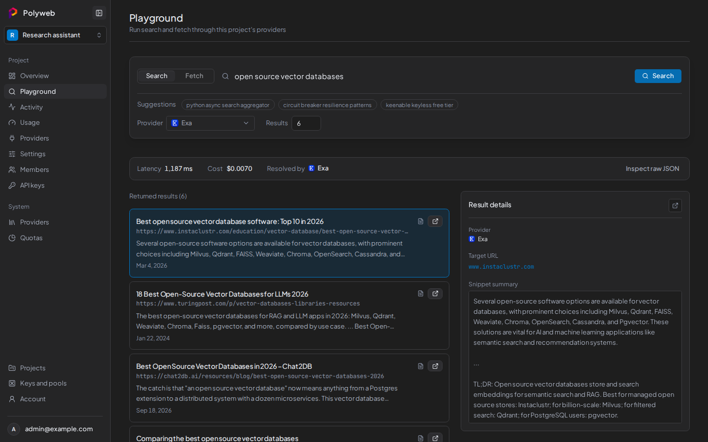
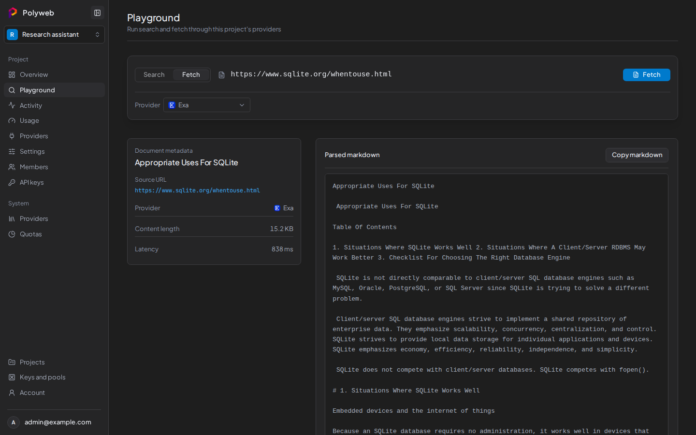

The Playground sends real `search` and `fetch` calls through your project's providers, so you can try a query before you write code. The calls cost what they cost and show up in [Activity and traces](/dashboard/activity/). Search needs the **Run searches** permission and fetch needs **Fetch pages**. A tab you can't use stays visible but disabled.

If the project has no provider set up, the page says "No provider is set up for this project" and links to **Set up providers**. See [Project providers](/dashboard/project-providers/).

## Run a search

1. Open your project, then open **Playground**. The **Search** tab is selected.
2. Type a query in **Search the web**, or select one of the **Suggestions**.
3. Pick a **Provider**: **Auto** (routing decides), **All providers** (every provider, fused into one list), or one named provider.
4. Set **Results**, from 1 to 100. The default is 6.
5. Select **Search**.

The bar above the results shows **Latency**, **Cost** and **Resolved by**, which is the provider that answered. **Returned results** lists each hit with its title, URL and snippet. Select a result to open it in the inspector beside the list.

Below the inspector, the **Execution waterfall** shows which providers ran, how long each took and whether each succeeded, failed, was rate limited or was skipped. **Inspect raw JSON** shows the full response, with a **Copy JSON** button.

## Fetch a page

1. Select the **Fetch** tab.
2. Paste a page address into **URL to fetch**.
3. Pick a **Provider**, or leave **Auto**.
4. Select **Fetch**.

The left panel shows **Document metadata**: the title, **Source URL**, **Provider**, **Content length** and **Latency**. The right panel shows the **Parsed markdown**, with a **Copy markdown** button. Fetch takes one URL per call and shows no waterfall, because one URL means one provider call.

You can also fetch from a search: each result has a fetch icon ("Fetch this page") that runs a fetch for that URL.

## Things to know

Your query, URL and last results are kept per project, so they survive switching pages and reloading. Switching projects starts clean. A request that is running keeps going if you open another page.

If a fetch fails, the page shows a short explanation (blocked site, timeout, out of credits, or no readable content) with the provider's message underneath. Try another **Provider**, or check [Usage](/dashboard/usage/) and [System providers and quotas](/dashboard/system-admin/) if you suspect a spent budget.

## Next steps

- Find the call you just made in [Activity and traces](/dashboard/activity/).
- Call the same operations from code with the [REST API](/api/overview/) or the [MCP server](/mcp/connect/).
