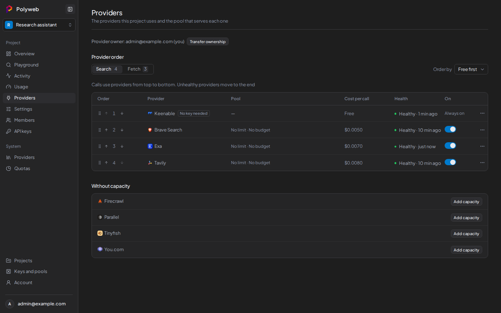

The **Providers** section shows which providers one project can call and in what order Polyweb tries them. You need permission to read providers to open it.

## Read the provider order

The **Provider order** panel has a **Search** tab and a **Fetch** tab, each with the number of providers in it. Under each tab a table lists the providers in the order Polyweb tries them, from top to bottom. A provider that is unhealthy moves to the end.

| Column | Meaning |
| --- | --- |
| **Order** | The provider's position. |
| **Provider** | The provider name. A "No key needed" tag marks providers that work without a key. |
| **Pool** | The pool serving this project, with its rate and budget use. "No pool" means nothing serves this provider yet. |
| **Cost per call** | The catalog price for one call of this operation. |
| **Health** | Whether the provider is currently responding. |
| **On** | Whether the project uses this provider for this operation. |

Providers that the project has no pool for appear under **Without capacity**. If a provider is switched off for the whole installation, its row says "Disabled by system". A system admin can turn it back on under **Providers** in the System group of the sidebar.

If a pool exists but doesn't allow the operation, the provider is missing from the tab, and a line below the table says "Not in this list" with its name. Edit the pool to allow that operation.

## Change the provider order

You need the permission to configure providers.

1. Open the **Search** or **Fetch** tab.
2. Pick an option from **Order by**: **Free first**, **Lowest cost**, or **Custom**.
3. For a custom order, drag a row, or use the "Move priority up" and "Move priority down" buttons on its handle.

A custom order must list every provider in the tab. If the list is out of date, for example because someone else changed it, the API returns `ORDER_STALE`; reload the page and try again.

Changes save at once. Moving a row switches the order to **Custom**. If you change your mind, press **Undo** to go back to the previous order. **Custom** stays disabled until you have saved a custom order at least once.

Search and fetch have separate orders, so change both if you want them to match.

## Turn an operation on or off for a provider

The switch in the **On** column controls whether this project uses a provider for that operation. Only the project's provider owner can change it. For everyone else the switch is read-only. If you turn off the last operation a pool allows, Polyweb asks you to confirm first.

## Add and manage capacity

Capacity means a pool for this project. The project's provider owner can:

- Press **Add capacity**, either in the banner or beside a provider under **Without capacity**. Choose the provider and one of your keys, press **Continue**, then set the pool as described in [Provider keys and pools](/dashboard/provider-keys/). If you have no key for that provider yet, the dialog asks you to add one first.
- Open the row menu and press **Edit pool** to change a pool's operations, rate, or budget.
- Press **Unassign** and confirm to stop the project from using a pool. The pool stays in your vault.
- Press **Add a key for higher limits** on a keyless provider such as Keenable.

If you are not the provider owner, you see "The provider owner must add capacity". The owner's email is shown on the page.

## The provider owner

Each project has one provider owner. Only that person can add or remove capacity, because the keys come from their vault.

A project admin can press **Claim provider ownership** when the project has none, and can use **Transfer ownership** to hand it over from the [Members](/dashboard/project/) page. Claiming makes you the owner. Add capacity afterwards, since calls fail until a pool exists.

## Troubleshooting

| Symptom | Fix |
| --- | --- |
| "No providers yet" | No pool serves this project. Ask the provider owner to add capacity. |
| "No provider serves Search" (or Fetch) | No pool of this project allows that operation. Edit a pool to allow it. |
| A provider shows "Off for Search" | Its pool doesn't allow search, or the system switch is off. |
| You can't reorder providers | You need permission to configure providers. Ask a project admin. |
| The **Providers** link is missing | You lack permission to read providers. Ask a project admin. |
| "Provider capacity is not available yet" | The capacity API isn't served by this installation. Use **Retry** or check the API server. |

## Next steps

- [Create a project API key](/dashboard/api-keys/) for your agent.
- [Routing](/concepts/routing/) explains how Polyweb picks a provider for each call.
