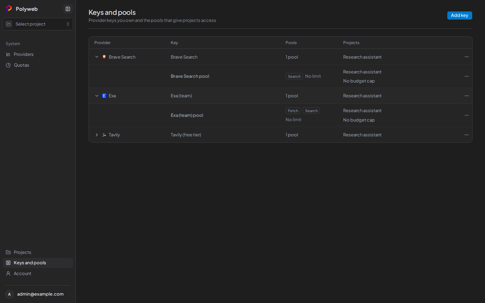

Polyweb stores your provider keys in an encrypted vault, never in `.env`. A project can only use a key after you give it a pool. You do all of this on **Keys and pools** in the sidebar, which system admins and project admins can open.

## How keys, pools, and projects fit together

A **provider key** is a secret you got from a provider such as Tavily or Exa. It belongs to your account.

A **key pool** (pool for short) grants one key to one project for the operations you choose (`search`, `fetch`, or both). A pool also carries a request rate limit and an optional budget. One key can have several pools, one per project.

When a search runs, Polyweb looks at the project's pools to see which providers it may call. If a provider is missing from a project, the break is almost always a missing pool, or a pool that doesn't allow that operation. The [Project providers](/dashboard/project-providers/) page shows the result.

## Add a provider key

1. Press **Add key**.
2. Choose the **Provider**.
3. Enter a **Label** to recognise the key later.
4. Paste the secret into **API key**.
5. Press **Add key**.

Parallel also offers an **Authentication** choice. Pick **OAuth** to connect without a pasted secret, then follow the **Connect Parallel** dialog: copy the code, open the verification page, and approve.

Under **Advanced** you can record what the provider allows for this key:

| Field | Meaning |
| --- | --- |
| **Key limit** | Requests the provider allows for this key. Leave it empty if you don't know. |
| **Rate unit** | **Per second**, **Per minute**, or **Per hour**. |
| **Overcommit** | Lets the pool limits add up to more than the key limit, so a busy pool can use idle capacity from other pools. |
| **When pools compete** | **Equal split** or **By pool size**. |

Keenable works without a key, so it shows up as "No key needed" in provider lists. You only add a Keenable key for higher limits.

## Create a pool for a project

1. Find the key in the table (columns **Provider**, **Key**, **Pools**, **Projects**).
2. Open the row menu and press **Create pool**.
3. Pick the **Project**. The list shows only projects where you are the provider owner and that don't yet have this provider.
4. Under **Allowed operations**, tick **Search**, **Fetch**, or both. Providers that don't support an operation say so. Brave, for example, has no Fetch.
5. Set **Request rate** and its **Rate unit**. The default is 60 per minute. To set different limits, turn on **Limit Search and Fetch separately**.
6. To cap spend, turn on **Budget**, enter **Budget (USD)**, and pick a period of day, week, or month. Calls with no known cost don't count toward it.
7. Press **Create pool**.

A project can have one pool per provider. If you try to add a second, you see "This project already has a pool for this provider". If the pool's limits add up to more than the key limit, the save fails unless **Overcommit** is on. See [Rate limits and budgets](/concepts/limits-and-budgets/) for how limits and budgets behave.

## Manage keys and pools

Expand a key row to see its pools. Each pool has a menu:

| Action | What it does |
| --- | --- |
| **Edit pool** | Change the pool name, operations, rate, or budget. |
| **Copy to another project** | Creates a second pool from the same key for another project. |
| **Assign to project** | Gives a pool that has no project to one. |
| **Remove from project** | Calls stop in that project. The pool stays in your vault. |
| **Delete pool** | Removes the pool for good. |

Each key has its own menu:

| Action | What it does |
| --- | --- |
| **Create pool** | See above. |
| **Rotate key** | Replaces the secret. Every pool that uses the key switches to the new one at once. Not available for OAuth keys. |
| **Edit key** | Changes the label and the **Advanced** settings. |
| **Connect** or **Disconnect** | For OAuth keys only. |
| **Delete key** | Deletes the key and all its pools. The confirmation names the projects that lose access. |

Secrets are write-only. Polyweb never shows a stored key again, so rotate it if you lose track of it.

## Permissions

You need to be a system admin or a project admin to open **Keys and pools**. You can only add a pool to a project where you are the provider owner. Each project has one provider owner, shown on its **Providers** page.

## Next steps

- [Project providers](/dashboard/project-providers/) shows which providers a project can use and in what order.
- [Providers](/providers/overview/) lists what each provider supports.
