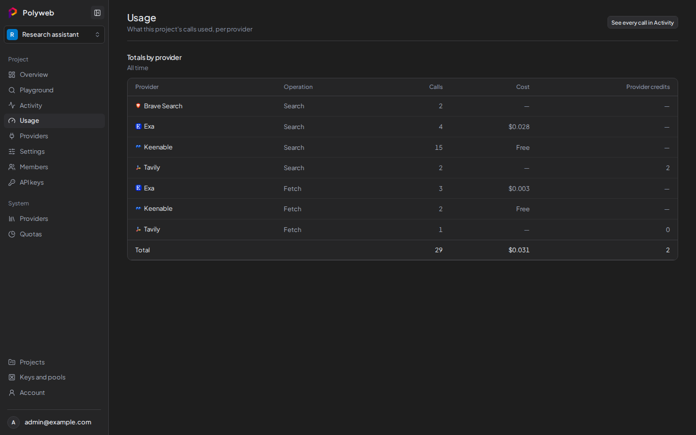

The **Usage** page totals a project's calls per provider and operation, over all time. You need the **View usage** permission. For individual calls, use [Activity and traces](/dashboard/activity/).

## Read the totals

1. Open your project, then open **Usage**.
2. Read **Totals by provider**. Each row is one provider and one operation (`search` or `fetch`).

| Column | Meaning |
| --- | --- |
| **Provider**, **Operation** | The provider and whether the row counts searches or fetches. |
| **Calls** | How many calls ran. |
| **Cost** | Reported charges in US dollars. Shows **Free** for keyless calls and a dash when the provider reported no cost. Totals include known costs only. |
| **Billed requests** | Calls counted against a provider's request allowance. Shown only when a provider reports them. |
| **Provider credits** | Credits the provider deducted, in its own unit. Shown only when a provider reports them. |
| **Other units** | Units recorded before unit types were tracked. |

Units never mix: dollars, requests and credits each keep their own column. When more than one row is listed, a **Total** row sums the calls and each column.

Select **See every call in Activity** (top right) to open the call list.

## Questions this answers

To see whether searches cost money, find the provider's `search` row and read **Cost**. To compare operations, put a provider's `search` and `fetch` rows side by side. The provider's remaining allowance isn't here. Admins see that in [System providers and quotas](/dashboard/system-admin/).

## Troubleshooting

| Symptom | Fix |
| --- | --- |
| **Usage** is missing from the sidebar | You lack **View usage**. Ask a project admin. |
| "Usage is unavailable" | Select **Retry**. If it persists, check that the API server is running. |
| A call you expect is missing | Totals appear after calls are recorded. Check [Activity and traces](/dashboard/activity/) for the call itself. |
