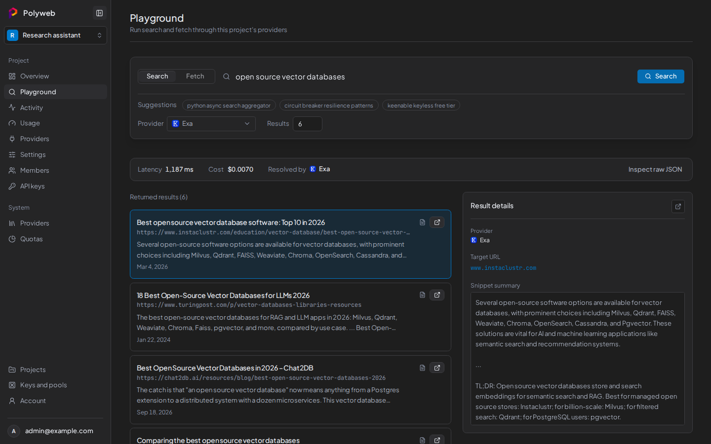

You will go from a fresh install to a working search in the dashboard, then make the same call with a project API key. You need a running Polyweb (see [Quick start](/quick-start/)) and a system admin account.

## Create a project

A project holds its own providers, members, and API keys. Only a system admin can create projects.

1. Sign in at `http://localhost:3000`.
2. Open **Projects** and create a project.
3. Open the project. Its pages are **Overview**, **Playground**, **Activity**, **Usage**, **Providers**, **Settings**, **Members**, and **API keys**.

## Add a provider key

Provider keys live in an encrypted vault, never in `.env`. Keenable works without a key. For every other provider, you need an account and a key from that provider. [Provider overview](/providers/overview/) shows what each one supports.

1. Open **Keys and pools** from the account menu and select **Add key**.
2. Create a pool that offers `search` and `fetch`, and add your key to it.
3. Bind the pool to your project.
4. Open the project's **Providers** page and check that the operations you need appear as available.

Brave supports search only, so pick a provider with fetch support if you want to try fetch too.

## Run a search in the Playground

1. Open your project, then **Playground**.
2. Stay on the **Search** tab, type `solar panel prices`, and run the search.

The results show the provider that answered, the latency, and the cost.



If the **Search** tab is disabled, your account lacks the `search.execute` scope. A project admin can grant it.

## Fetch a page

1. Select the **Fetch** tab.
2. Paste one full URL, such as `https://example.com`.
3. Optionally pick a provider. **Auto** chooses one for you.
4. Run the fetch and read the page text.

The **Fetch** tab needs the `fetch.execute` scope. A fetch accepts one URL per call.

## Make the same call with an API key

The Playground uses your sign-in. Agents and code use a project API key instead.

1. Open the project's **API keys** page and create a key with `search.execute` and `fetch.execute`.
2. Copy the key when it is shown. You cannot read it again later.
3. Call the REST API. Replace `fs_live_REPLACE_ME` with your key.

```bash
curl -X POST http://localhost:8001/search \
  -H "Authorization: Bearer fs_live_REPLACE_ME" \
  -H "Content-Type: application/json" \
  -d '{"query": "solar panel prices", "limit": 5}'
```

Open **Activity** in the dashboard to see the call you just made as a trace.

## Troubleshooting

| Symptom | Fix |
| --- | --- |
| An error right after you run a search | The project has no usable provider. Check the **Providers** page and your pool binding. |
| `402` or `429` | A budget or rate limit is used up. Wait, or ask an admin to raise it. |
| `422` on fetch | The URL is empty or malformed. Paste one full `http://` or `https://` URL. |
| You are sent back to sign in | Your session expired. Sign in again. |

## Next steps

- [Connect an agent](/mcp/connect/) (Codex, Claude Code, or OpenCode) to use `search` and `fetch` as tools.
- [Call the REST API](/api/overview/) from your own code.
- [Provider keys and pools](/dashboard/provider-keys/) explains how a call picks a key.
