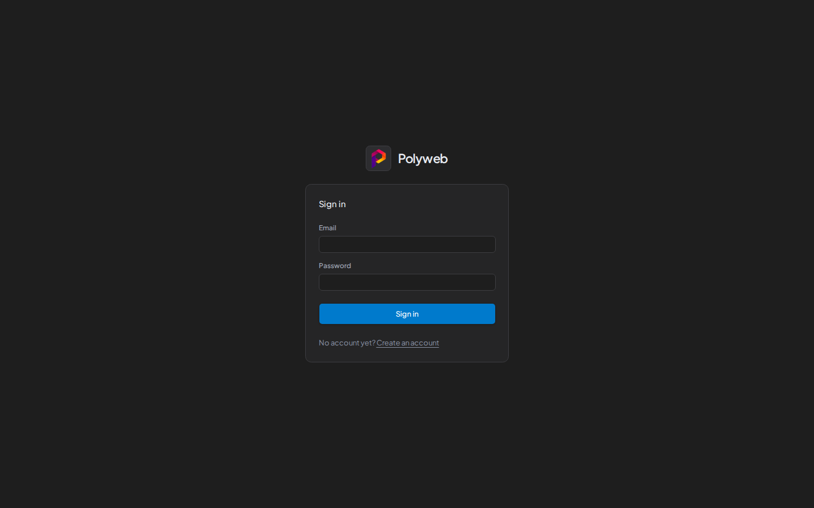

import ConnectAgent from '../../components/ConnectAgent.mdx';

Docker starts the dashboard, the API server, and the MCP server with one command. You need Docker with Docker Compose and `git`. Prefer to run it without Docker? See [Manual setup](/setup/manual/).

## Start Polyweb

There is no prebuilt image, so you clone the repository and build it. The first build takes a few minutes.

1. Clone the repository.

   ```bash
   git clone https://github.com/polyweb-dev/polyweb-mcp.git
   cd polyweb-mcp
   ```

2. Create your `.env` file.

   ```bash
   cp .env.example .env
   ```

3. Set the secrets and the dashboard origin. `POLYWEB_AUTH_JWT_SECRET` signs sign-in tokens and must hold at least 32 random bytes. `POLYWEB_AUTH_BROWSER_ORIGINS` tells the API which browser address may sign in. It must match the address you open the dashboard at. If you change `UI_PORT` later, change the origin to match.

   ```bash
   sed -i "s|^POLYWEB_AUTH_JWT_SECRET=.*|POLYWEB_AUTH_JWT_SECRET=$(openssl rand -hex 32)|" .env
   sed -i 's|^# POLYWEB_AUTH_BROWSER_ORIGINS=.*|POLYWEB_AUTH_BROWSER_ORIGINS=["http://localhost:3000"]|' .env
   ```

   The origin is a JSON list and must match the dashboard address exactly, including the port. Without it, sign-in fails with "The server returned a refresh credential to the browser."

   On macOS, use `sed -i ''` instead of `sed -i`.

4. Build and start the stack.

   ```bash
   docker compose up --build -d
   docker compose ps
   ```

Wait until `api` shows `healthy` in `docker compose ps`. The dashboard starts after the API is healthy. Docker checks `GET /health`, which returns only `{"status":"ok"}` and requires no credentials.

| Service | Address | Host port setting |
| --- | --- | --- |
| Dashboard | `http://localhost:3000` | `UI_PORT` |
| API server and Swagger docs | `http://localhost:8001/docs` | `API_PORT` |
| MCP server | `http://localhost:8000/mcp` | `MCP_PORT` |

To change a host port, add the variable to `.env`, for example `printf '\nUI_PORT=3100\n' >> .env`, and update `POLYWEB_AUTH_BROWSER_ORIGINS` to the new dashboard address. If you run Polyweb on another machine, replace `localhost` with that machine's address. Sign-in outside `localhost` needs HTTPS, so see [Configuration](/setup/configuration/#sign-in-from-a-browser).

Compose uses the project name `polyweb`, even when the checkout folder has another name. The default containers are `polyweb-api-1`, `polyweb-mcp-1`, and `polyweb-ui-1`. Use `COMPOSE_PROJECT_NAME` or `docker compose -p NAME` for a separate stack.

The database and encryption key share the `polyweb_polyweb-data` Docker volume. The volume name starts with your project name if you set a custom name.

## Create an account

Registration on the dashboard sign-in page creates ordinary accounts only. A system admin, who can create projects, comes from the command line. For the first account, create an admin. The command asks for a password once at a masked prompt, so run it in an interactive terminal. Piping a password in does not work. The first run can take a few seconds while `uv` syncs inside the container.

```bash
docker compose exec api uv run polyweb-users create-admin --email admin@example.com
```

Replace `admin@example.com` with your email address. More commands are in [Admin accounts](/setup/admin-accounts/).

## Sign in

Open `http://localhost:3000` and sign in with that email and password.



## Create a project and an API key

1. Open **Projects** and create a project, then open it.
2. Open **API keys** in the project sidebar.
3. Enter a **Label**, tick **Search** and **Fetch**, and press **Issue key**.
4. Press **Copy key**. Polyweb shows the key only once.

More options are in [Project API keys](/dashboard/api-keys/). To make search work, bind a provider to the project with [Your first search](/guides/first-search/).

## Connect an agent

<ConnectAgent />

For other clients, stdio, and error messages, see [Connect an agent](/mcp/connect/).

## Troubleshooting

| Symptom | Fix |
| --- | --- |
| Sign-in fails with an error | `POLYWEB_AUTH_BROWSER_ORIGINS` is empty or does not match the address in your browser. Set it to the exact origin, then run `docker compose up -d`. |
| `POLYWEB_AUTH_JWT_SECRET is required for account authentication` in `docker compose logs api` | The secret is empty. Set it in `.env`, then run `docker compose up -d`. |
| A port is already in use | Set `UI_PORT`, `API_PORT`, or `MCP_PORT` to a free port in `.env`, update `POLYWEB_AUTH_BROWSER_ORIGINS` if you changed `UI_PORT`, then run `docker compose up -d`. |
| The dashboard returns `502` after you recreate the `api` container | Run `docker compose restart ui`. |
| `create-admin` reports a missing database file | Wait for `api` to be healthy and run the command again. |
