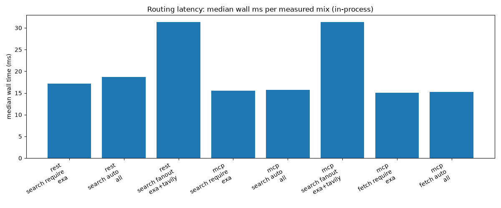
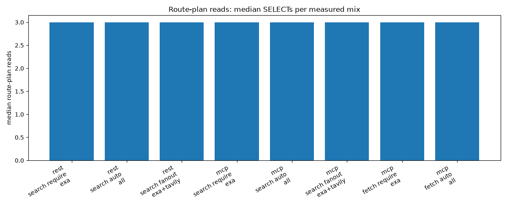

# Routing latency report

## Method
Direct latency measurement. Each sample wraps one complete API request with
time.perf_counter(): an in-process REST POST via httpx.ASGITransport or an
in-process MCP server.call_tool call. Route-plan reads count foreground
SELECT statements observed on the repository engine during the request.
Telemetry and provider writes are INSERTs, so SELECTs isolate the plan.

## Harness
In-process harness, NOT network latency. REST uses httpx.ASGITransport
against the FastAPI app; MCP uses create_server plus server.call_tool.
Wall times exclude TCP/TLS/HTTP wire cost and must not be read as
production network latency.

## Commit
4cf438f

## Environment
- python: 3.12.13 (main, Jul 18 2026, 17:08:38) [MSC v.1944 64 bit (AMD64)]
- platform: Windows-11-10.0.26200-SP0
- sqlite: 3.53.1

## Request mixes
| transport | operation | routing_mode | providers | payload |
|---|---|---|---|---|
| rest-inprocess | search | require | exa | POST /search {"query", "routing": {"mode": "require", "providers": ["exa"]}} |
| rest-inprocess | search | auto | all | POST /search {"query"} |
| rest-inprocess | search | fanout | exa+tavily | POST /search {"query", "fanout": true, "routing": {"mode": "fanout", "providers": ["exa", "tavily"]}} |
| mcp-inprocess | search | require | exa | call_tool search {"query", "routing": {"mode": "require", "providers": ["exa"]}} |
| mcp-inprocess | search | auto | all | call_tool search {"query"} |
| mcp-inprocess | search | fanout | exa+tavily | call_tool search {"query", "fanout": true, "routing": {"mode": "fanout", "providers": ["exa", "tavily"]}} |
| mcp-inprocess | fetch | require | exa | call_tool fetch {"url", "routing": {"mode": "require", "providers": ["exa"]}} |
| mcp-inprocess | fetch | auto | all | call_tool fetch {"url"} |

## Cache preparation
Before each mix both caches are cleared (clear_config_cache and
clear_quota_poll_cache); one cold probe runs first (cache_state cold).
Then each of the seven providers is pre-warmed via
effective_config_for_name plus routing_policy; ten warmup rows follow
(cache_state warm, phase warmup); thirty measured rows follow
(cache_state warm, phase measured). After every request the tasks in
_BACKGROUND_TASKS are drained so samples stay serial and isolated.

## Fixtures and policy
- Real temporary SQLiteRepository per test function, seeded per provider
  with AUTHORITATIVE remaining 10 / limit 10 quota and HEALTHY status.
- Seven offline stub adapters (quota() returns None so no poll delay;
  health UNKNOWN). adapter_mode is offline for every row.
- Default routing policy; concurrency is serial on one event loop.

## Sample counts
- cold probes: 8 (one per mix)
- warmup rows: 80 (ten per mix)
- measured rows: 240 (thirty per mix)
- total data rows: 328

## Measured results
Statistics cover successful (status ok) measured rows only; failures are
counted separately.
| mix | measured | failures | median ms | p95 ms | max ms | median reads |
|---|---|---|---|---|---|---|
| rest-inprocess search require exa | 30 | 0 | 17.143 | 32.858 | 36.080 | 3.000 |
| rest-inprocess search auto all | 30 | 0 | 18.658 | 33.933 | 56.412 | 3.000 |
| rest-inprocess search fanout exa+tavily | 30 | 0 | 31.333 | 41.531 | 51.349 | 3.000 |
| mcp-inprocess search require exa | 30 | 0 | 15.499 | 38.208 | 45.709 | 3.000 |
| mcp-inprocess search auto all | 30 | 0 | 15.758 | 28.138 | 39.397 | 3.000 |
| mcp-inprocess search fanout exa+tavily | 30 | 0 | 31.373 | 46.471 | 47.320 | 3.000 |
| mcp-inprocess fetch require exa | 30 | 0 | 15.017 | 33.997 | 35.216 | 3.000 |
| mcp-inprocess fetch auto all | 30 | 0 | 15.262 | 35.926 | 40.254 | 3.000 |

## Percentile method
Median is the 50th percentile; p95 is the 95th percentile. Percentiles
use linear interpolation between closest ranks: rank = (n - 1) * p, then
value = lower + (upper - lower) * fraction. Single-sample groups use the
sample; empty groups report 0.0.

## Reproduction
`uv run --with matplotlib pytest tests/integration/latency/test_routing_latency.py -q`

## Limitations
- Expired-TTL probes were not collected in this run.
- trace_id is empty: the in-process harness has no distributed trace.
- In-process wall time is not network latency.
- No before/after speedup is claimed from these samples.
- Route-plan read counts are available for every measured group.

## Charts

